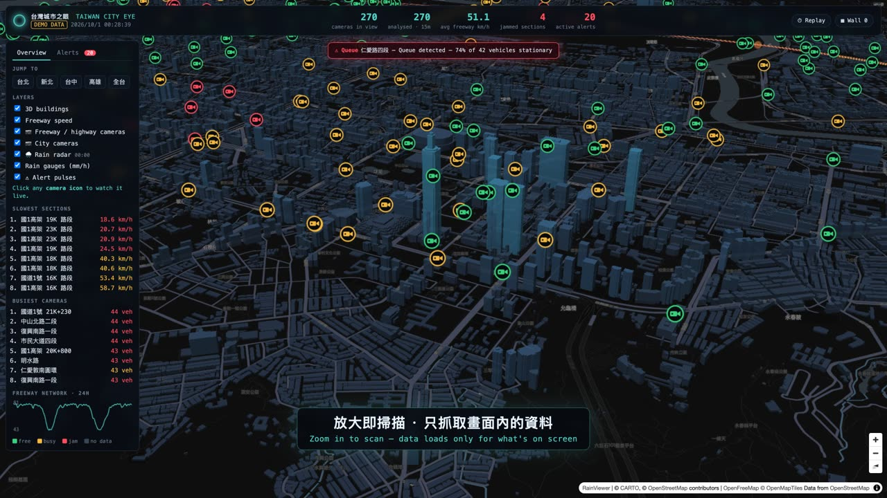
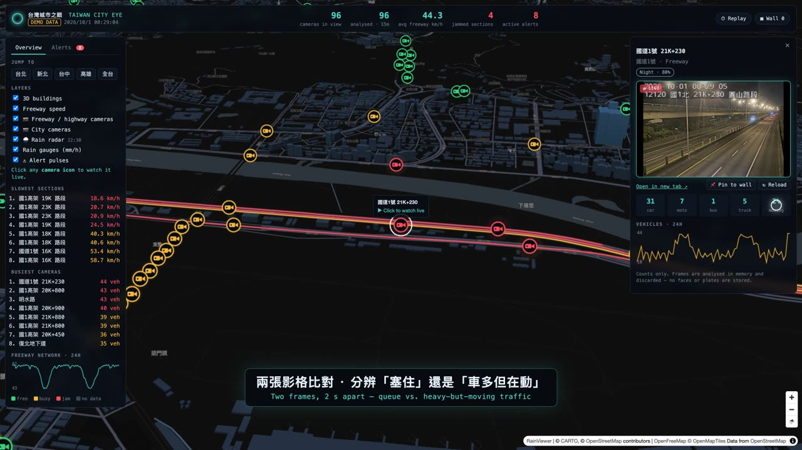
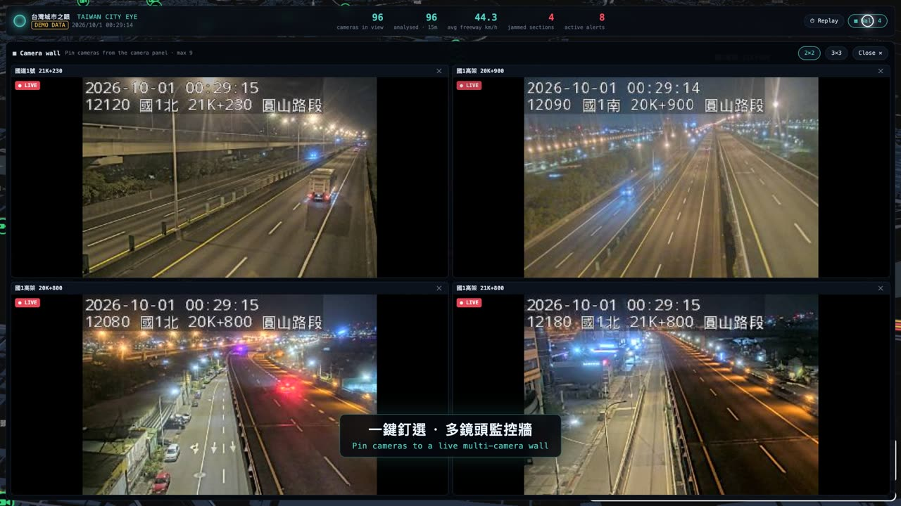
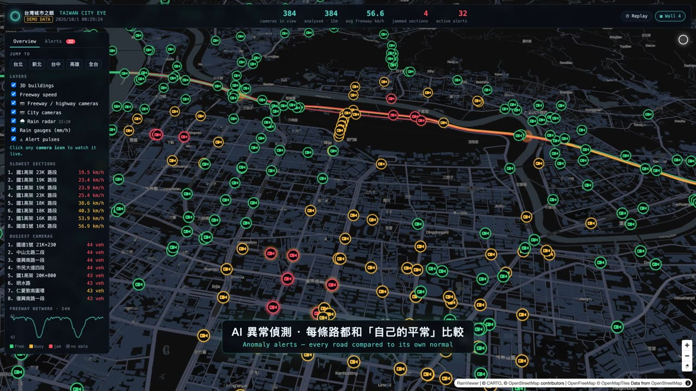
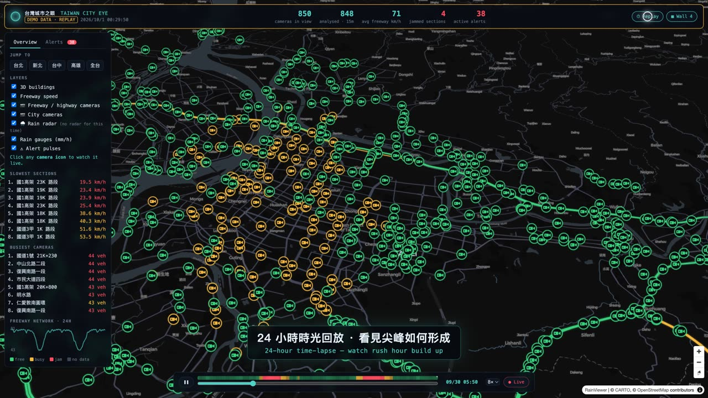

# 台灣城市之眼 · Taiwan City Eye

**A real-time "ops room" for Taiwan's roads** — live traffic cameras, freeway speeds, AI vehicle analysis,
anomaly alerts, rain radar and a 24-hour time-lapse, on a 3D map. Built entirely on free, public open data.

> 即時交通態勢系統：整合交通部 TDX 路口／國道監視器、國道即時車速、AI 車流分析、異常警報、雨量雷達與 24 小時回放，
> 全部使用政府開放資料。**只看車流，不看人臉。**



**Flows, not faces.** Taiwan City Eye watches traffic *conditions*, never people: camera frames are analysed in
memory and immediately discarded, only vehicle counts are stored, and there is no face or licence-plate
recognition and no cross-camera tracking.

---

## Features

| | |
|---|---|
| **🗺 3D city map** — dark basemap with real building heights; freeway sections coloured by live speed. Data loads only for the area on screen, only once you zoom in. | **📷 ~5,000 live cameras** — 國道, 省道, 台北市, 新北市 from TDX. Click any camera to watch it in the side panel. |
|  |  |
| **🤖 AI vehicle analysis** — YOLO counts cars / scooters / buses / trucks; two frames 2 s apart tell a *queue* from heavy-but-moving traffic. CLIP tags road conditions (wet, flood, fog, smoke). | **▦ Camera wall** — pin up to 9 cameras and watch them side by side in a 2×2 or 3×3 grid. |
|  |  |
| **⚠ Anomaly alerts** — every road and camera is compared to *its own* normal for that hour: slowdowns, surges, queues, stopped vehicles, flooding. Pulsing rings, an alert feed and pop-ups. | **⏱ 24-hour replay** — scrub back through a day of speeds, counts and alerts for the area in view. Plus **🌧 rain radar** (RainViewer) and **rain gauges** (中央氣象署). |

A **demo mode** with simulated data runs with zero setup, so you can try everything in two minutes.

---

## Quick start (2 minutes, no API keys)

Requires **Python 3.10+** and **git**.

```bash
git clone https://github.com/zai950819-oss/Taiwan_city_Eye.git
cd Taiwan_city_Eye
python3 -m venv .venv
source .venv/bin/activate            # Windows: .venv\Scripts\activate
pip install -r requirements.txt
uvicorn godeye.main:app --reload
```

Open **http://127.0.0.1:8000** — the map starts over Taipei 101. With no keys configured it runs in
**mock mode** (badge top-left): simulated speeds, cameras, incidents and 24 h of history.

---

## Tutorial: set it up with real data on your own machine

### 1. Install

Follow the quick start above. Everything below happens inside the activated virtual environment.

> 💡 **Using conda?** If you see `ModuleNotFoundError: fastapi / httpx`, your shell is running conda's Python
> instead of the venv's. Call it explicitly: `.venv/bin/python -m uvicorn godeye.main:app`
> (Windows: `.venv\Scripts\python -m uvicorn godeye.main:app`).

### 2. Get free TDX keys (交通部 TDX 運輸資料流通服務)

1. Register at **https://tdx.transportdata.tw** (免費會員).
2. Go to **會員中心 → API 金鑰** and create a key. You get a **Client ID** and a **Client Secret**.

### 3. Configure `.env`

```bash
cp .env.example .env        # Windows: copy .env.example .env
```

Open `.env` and fill in:

```ini
TDX_CLIENT_ID=your-client-id
TDX_CLIENT_SECRET=your-client-secret
GODEYE_CCTV_SOURCES=Freeway,Highway,City/Taipei,City/NewTaipei
```

`.env` is in `.gitignore` — your keys never get committed. Other cities work too
(`City/Taichung`, `City/Kaohsiung`, `City/Taoyuan`, …).

### 4. Check the connection

```bash
python scripts/probe_tdx.py
```

It prints a sample of each TDX dataset. If you see JSON with `CCTVID` / `VideoStreamURL`, you're connected.

### 5. Run with live data

```bash
rm -f data/godeye.db          # clear mock data (Windows: del data\godeye.db)
uvicorn godeye.main:app
```

Zoom in (zoom ≥ 11) anywhere in Taiwan: cameras and freeway speeds load for that area only.
The badge now reads **LIVE**.

> Alerts compare each road to its own history, so they need data first: they appear after you've watched an
> area for a while and get better over the following day.

### 6. Optional: AI vision

```bash
pip install -r requirements-vision.txt
```

Installs YOLOv8 (vehicle counting + motion) and CLIP (road-condition tags). Models download on first use
(~650 MB). A GPU helps but isn't required; only cameras on screen are analysed. Tune the load in `.env`:
`GODEYE_VISION_MAX_CAMERAS`, `GODEYE_VISION_INTERVAL_S`.

### 7. Optional: rain gauges (中央氣象署)

Get a free authorization key at **https://opendata.cwa.gov.tw** (會員 → API 授權碼) and add
`CWA_API_KEY=...` to `.env`. The rain radar layer works without any key.

### 8. Optional: record a demo video

```bash
pip install -r requirements-demo.txt
python -m playwright install chromium        # skip if Google Chrome is installed
python scripts/record_demo.py --author "Built by <you>"
python scripts/add_music.py demo/your-track.mp3   # optional background music, auto-synced to the drops
```

Produces a 1080p MP4 with bilingual captions in `demo/`, using a scripted demo scenario (simulated numbers;
real camera positions and live freeway feeds if you've run with TDX keys before). Keep the browser window
visible while it records.

---

## Using the app

| Action | How |
|---|---|
| Tilt / rotate the 3D view | Right-drag (or Ctrl + drag) |
| Load data for an area | Zoom in to level 11+ — nothing is fetched when zoomed out |
| Watch a camera | Click a camera icon → live view in the side panel |
| Camera wall | 📌 **Pin to wall** in the camera panel, then **▦ Wall** (top right) |
| Alerts | **Alerts** tab (left) or click a pulsing ring |
| Replay | **⏱ Replay** (top right) · Space = play/pause · ←/→ = step |
| Layers | Left panel: 3D buildings, freeway speed, camera types, rain radar, gauges, alert pulses |

---

## Configuration (`.env`)

| Variable | Default | Purpose |
|---|---|---|
| `TDX_CLIENT_ID` / `TDX_CLIENT_SECRET` | — | TDX credentials. Missing → mock mode |
| `GODEYE_MOCK` | `0` | Force mock mode even with keys |
| `GODEYE_CCTV_SOURCES` | `Freeway,Highway,City/Taipei` | Camera sets to load |
| `GODEYE_VISION` | `1` | Enable YOLO analysis (if installed) |
| `GODEYE_VISION_MAX_CAMERAS` | `40` | Max cameras analysed per cycle |
| `GODEYE_VISION_INTERVAL_S` | `120` | Seconds between samples of the same camera |
| `GODEYE_CONDITIONS` | `1` | Enable CLIP road-condition tags (if installed) |
| `CWA_API_KEY` | — | Enables rain gauges |
| `GODEYE_RETENTION_HOURS` | `72` | How long history is kept |
| `GODEYE_DB` | `data/godeye.db` | SQLite file |

---

## How it works

```
TDX · CWA · RainViewer
        │  (fetched only for areas someone is viewing)
        ▼
 FastAPI backend ── background loops ──► SQLite (aggregates only)
   ├─ camera registry (6 h cache)          ├─ speeds, counts, alerts
   ├─ freeway speeds (60 s)                └─ 72 h retention
   ├─ vision: MJPEG → 2 frames → YOLO + CLIP → counts (frames discarded)
   └─ anomaly engine (60 s): each road vs. its own hour-of-day baseline
        │
        ▼
 Web client (MapLibre GL, no build step): 3D map · player · wall · alerts · replay
```

| Path | Role |
|---|---|
| `godeye/main.py` | API: `/api/cameras`, `/sections`, `/alerts`, `/replay`, `/rain`, `/status`, camera `/player`, `/stream`, `/snapshot` |
| `godeye/ingest.py` | Demand-driven background loops |
| `godeye/tdx.py` · `godeye/cwa.py` | Open-data clients |
| `godeye/vision.py` · `godeye/conditions.py` | YOLO counting + motion, CLIP condition tags |
| `godeye/analytics.py` | Anomaly rules and baselines |
| `godeye/mock.py` | Simulated data for mock / demo mode |
| `web/` | Front end (ES modules) |
| `scripts/` | TDX probe, demo recorder, music mixer |

Run the tests with `pip install pytest && pytest -q`.

---

## Troubleshooting

| Problem | Fix |
|---|---|
| `ModuleNotFoundError` | Use the venv's Python explicitly (see step 1) and `pip install -r requirements.txt` |
| Map is blank | The basemap and libraries load from CDNs (CARTO, OpenFreeMap, unpkg) — check your connection |
| "Zoom in to scan this area" | Intended: data loads at zoom ≥ 11 |
| A city camera stays black | Some agencies' player pages can't be embedded — use **Open in new tab** |
| No alerts yet | Alerts need history for that area; keep it on screen for a while |
| Port 8000 in use | `uvicorn godeye.main:app --port 8080` |

---

## Data sources & attribution

- **交通部 TDX 運輸資料流通服務** — cameras, freeway speeds and shapes · [政府資料開放授權條款](https://data.gov.tw/license)
- **中央氣象署 CWA 開放資料** — rain gauges
- **RainViewer** — rain radar tiles
- **OpenFreeMap** / **© OpenStreetMap contributors** — building heights
- **CARTO** — dark basemap style (check CARTO's terms before commercial use)
- Camera streams belong to their respective agencies (高公局, 公路局, 臺北市, 新北市) and are shown unmodified.

## Responsible use

This project is built for traffic awareness, not surveillance of people. Please keep it that way: don't add
face recognition, licence-plate reading or cross-camera tracking of individuals, and respect the terms of the
data providers.
